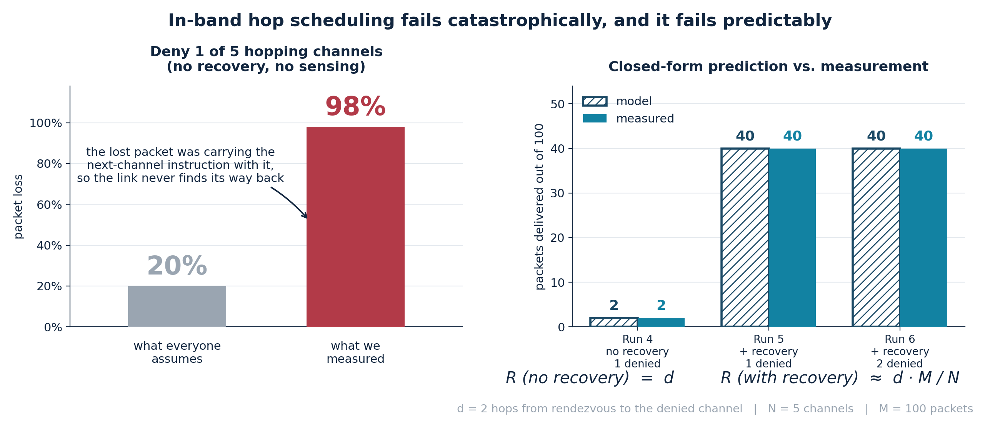
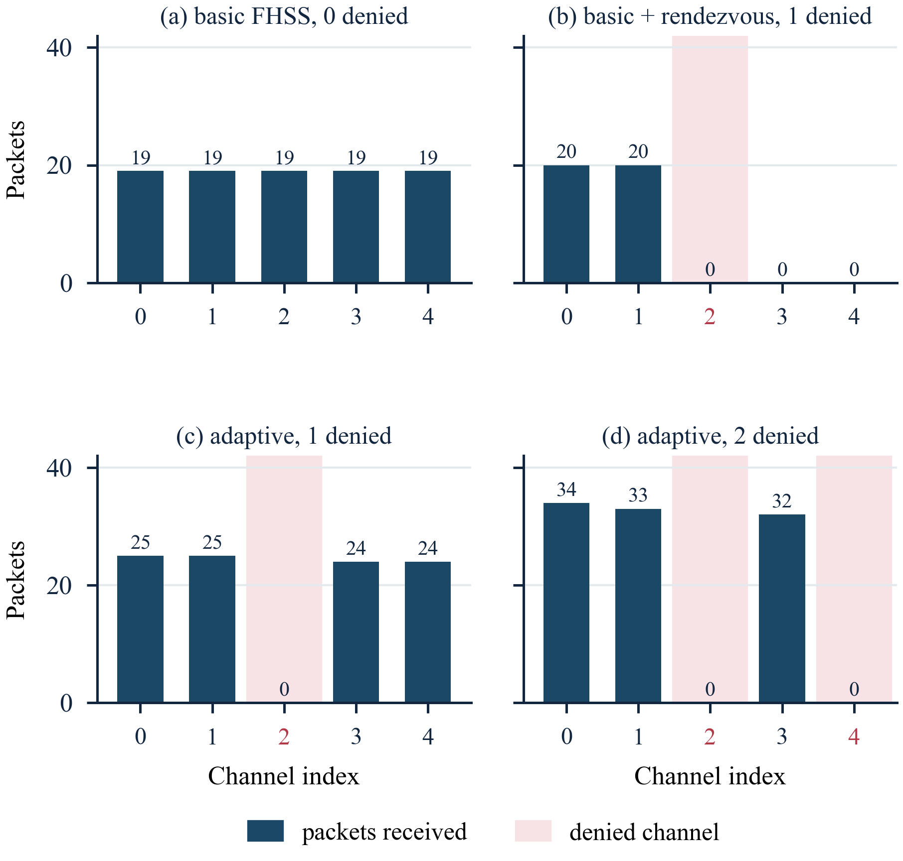

# Anti-Jam FHSS Telemetry Link

A two-node frequency-hopping radio link for UAV telemetry, built on ESP32 +
CC1101 at 433 MHz, together with the experiment harness, live dashboard and
measurements used to characterise how it fails.

**Headline result: when one of five channels is made unusable, a conventional
hopping link loses 98 % of its traffic. This one loses 2 %.**



---

## The interesting part

Frequency hopping is old. What this project measures is a failure mode of a
specific, very common way of building it cheaply.

To hop, both ends must agree on where to go next. The usual ways are a shared
clock or a dedicated control channel. Neither is attractive on a
microcontroller-class radio, so this link does what many low-cost designs do:
**each packet names the channel the transmitter will move to next.**

```
SEQ:71,NEXT:2 | CURRENT: 433.45 MHz | NEXT: 433.85 MHz
```

That is elegant and free. It also couples two failures that are normally
independent: **losing a packet also loses the schedule.** A packet dropped on
an unusable channel takes the next-channel instruction with it, and the
receiver is left listening on a channel the transmitter has already left.

So denying one channel of five does not cost 20 % of the traffic. Measured, it
cost **98 %** — an amplification of 4.9×.

Adding a cyclic rendezvous fallback bounds the damage, but the loss then
**saturates**: denying a *second* channel changed the delivered count by zero
packets, because the receiver never survived long enough to reach it. A
closed-form model reproduces three measured runs exactly, with no fitted
parameter:

| | predicted | measured |
|---|---|---|
| no recovery, 1 denied | *d* = **2** | **2** |
| + recovery, 1 denied | *d·M/N* = **40** | **40** |
| + recovery, **2** denied | **40** | **40** |

where *d* is the hop distance from the rendezvous channel to the first denied
one, *N* = 5 channels and *M* = 100 packets.

The fix is to stop losing the schedule in the first place: sense each channel
before hopping onto it, and skip the ones that read busy. That takes the same
hardware from 98 % loss to 2 %.

---

## What is implemented

| Component | What it does |
|---|---|
| `firmware/` | Five Arduino sketches: fixed-frequency TX/RX, basic FHSS TX/RX, adaptive TX with sense-before-hop |
| `analysis/dashboard.py` | Live ground station — reads both boards over USB, serves a web dashboard on `:8080`, lets you deny channels at runtime |
| `analysis/run_matrix.py` | Automated nine-configuration experiment harness; drives both boards, captures logs, writes `results.csv` |
| `analysis/flash_demo.py` | Flashes the demo build to both boards with retry and bootloader handling |
| `paper/` | Build pipeline that generates the IEEE manuscript from source, including all figures |

Protocol features, all on-device:

- **In-band hop scheduling** — no shared clock, no control channel
- **Clear-channel assessment** — pre-hop RSSI measurement against a −75 dBm threshold
- **Channel blacklisting with cooldown** — a refused channel is retried after 3 cycles
- **Rendezvous recovery** — receiver returns to channel 0 after 2 s of silence
- **Runtime-switchable modes** — hopping vs fixed-frequency, and channel denial, over the serial link without reflashing

---

## Hardware

| Item | Qty | Notes |
|---|---|---|
| ESP32 DevKit v1 | 2 | Protocol logic, SPI master, logging |
| CC1101 433 MHz module | 2 | 2-FSK transceiver, RSSI measurement |
| Quarter-wave antenna | 2 | One per transceiver |

**The CC1101 runs at 3.3 V. Powering it from 5 V destroys it.**

| CC1101 | ESP32 |
|---|---|
| VCC | 3.3 V |
| GND | GND |
| SCK | GPIO 18 |
| MOSI / SI | GPIO 23 |
| MISO / SO | GPIO 19 |
| CSN / CS | GPIO 5 |

### Radio configuration

| Parameter | Value |
|---|---|
| Modulation | 2-FSK, 99.97 kb/s, ±47.60 kHz deviation |
| Occupied bandwidth | ≈195 kHz (Carson) |
| Channels | 433.05 / 433.45 / 433.85 / 434.25 / 434.65 MHz |
| Channel spacing | 400 kHz |
| Receiver bandwidth | 270.83 kHz |
| Processing gain | ≈9.6 dB |
| Transmit power | +10 dBm conducted |
| Measured noise floor | −105.3 ± 1.6 dBm |

---

## Quick start

Requires Python 3.9+, `pyserial`, `matplotlib`, and `arduino-cli` for flashing.

```bash
pip install pyserial matplotlib
```

**1. Check both boards are detected**

```bash
python analysis/dashboard.py --ports
```

You should see two `Silicon Labs CP210x` entries. Only one showing usually
means a charge-only USB cable.

**2. Flash the demo firmware**

```bash
python analysis/flash_demo.py
```

**3. Run the live dashboard**

```bash
python analysis/dashboard.py
```

Open <http://localhost:8080>. Click any channel to deny it and watch the
transmitter route around it; switch to single-channel mode to see the
conventional link fail instead.

**4. Reproduce the measurement matrix**

```bash
python analysis/run_matrix.py
```

Runs all nine configurations end to end and writes `results/results.csv`.

**5. Rebuild the figures and the paper**

```bash
python paper/make_paper_figures.py
python paper/make_algo_figures.py
python paper/build_paper.py      # needs the IEEE template, see .gitignore
```

---

## Results

Every run is 100 packets at a measured 1.2 s cadence. Channel denial is
**emulated in firmware** (see below).

| Run | Mode | Recovery | Denied | Received | Loss |
|---|---|---|---|---|---|
| 1 | Fixed frequency | – | 0 | 100 | 0 % |
| 2 | Fixed frequency | – | 1 | 0 | **100 %** |
| 3 | Basic FHSS | no | 0 | 95 | 5 % |
| 4 | Basic FHSS | no | 1 | 2 | **98 %** |
| 5 | Basic FHSS | yes | 1 | 40 | 60 % |
| 6 | Basic FHSS | yes | 2 | 40 | 60 % |
| 7 | Adaptive | yes | 0 | 100 | 0 % |
| 8 | Adaptive | yes | 1 | 98 | **2 %** |
| 9 | Adaptive | yes | 2 | 99 | 1 % |

Per-channel delivery, which is where the mechanism becomes visible — note that
in (b) channels 3 and 4 receive *nothing*, because the receiver never gets past
channel 2:



Raw serial captures for every run are in [`results/`](results/).

---

## No interference is ever transmitted

Channel denial is **emulated in firmware**: a bit marks a channel as denied, the
transmitter's sensor then reports it as busy, and the receiver discards anything
arriving on it. Nothing in the setup radiates interference.

Two reasons:

- **Legal.** 433.05–434.79 MHz is licence-exempt in India under G.S.R. 347(E),
  2022, at 10 mW e.r.p. and 10 % duty cycle. Deliberately radiating
  interference to deny a band is not something you do on a bench.
- **Experimental.** Emulated denial is exactly repeatable, so every run denies
  the same channel at the same point and differences between runs are
  attributable to the protocol rather than to an uncontrolled noise source.

This validates the **decision and recovery logic**. It does not validate the RF
front end against a real interferer — that needs a signal generator in a
shielded enclosure.

---

## Honest limitations

These are stated in the paper and repeated here because they bound what the
numbers mean.

1. Denial is emulated, not transmitted. No real-interferer validation.
2. The delivery model is validated at a **single** operating point (*d* = 2).
3. **Single trials.** One run of 100 packets per configuration; no error bars.
   Differences of one or two packets carry no weight.
4. Five channels is a small hop set. Denying two removes 40 % of it.
5. The hop order is fixed and predictable; a real system would derive it from a
   shared secret. The rendezvous channel is a single point of failure and was
   never itself denied.
6. **The channel plan overruns the band edge.** Five channels at 400 kHz
   spacing need 1795 kHz; the band provides 1740 kHz. Found in review, after
   the measurements. It does not affect the scheduling results, but the
   compliance claim is conducted power only — e.r.p. was never measured.
7. Benchtop conditions. No claim is made against wideband denial: hopping helps
   when interference affects part of the hop set, and has nowhere to go when it
   does not.

---

## Paper

A full write-up is in [`paper/`](paper/) — 11 pages, 28 equations, 3 algorithms,
40 references, in IEEE Transactions format.

- [`FHSS_Anti_Jam_UAV_Telemetry_IEEE.pdf`](paper/FHSS_Anti_Jam_UAV_Telemetry_IEEE.pdf)
- [`DIFFERENTIATION.md`](paper/DIFFERENTIATION.md) — how this differs from the
  closest prior work
- [`PROJECT_EXPLAINED.md`](PROJECT_EXPLAINED.md) — end-to-end walkthrough: what each program does, what each experiment proves, what the numbers mean

The manuscript is generated from source: [`build_paper.py`](paper/build_paper.py)
writes OOXML directly into the IEEE template, and every figure is regenerated
from the measurement files by [`make_paper_figures.py`](paper/make_paper_figures.py),
so no number in the paper is typed in by hand.

---

## Repository layout

```
firmware/        Arduino sketches for all five node roles
  shared/        channel plan and radio configuration shared by every sketch
analysis/        dashboard, experiment harness, flashing, plotting
results/         raw serial captures and the measured run matrix
paper/           manuscript source, figure generators, reference tooling
```

---

## Authors

Rishit Sinha and Rupsa Mittra — Vellore Institute of Technology.
Faculty guide: Velmurugan T.

## License

MIT — see [`LICENSE`](LICENSE). The IEEE Transactions template and the
third-party papers used as references are **not** covered by it and are not
redistributed here.
